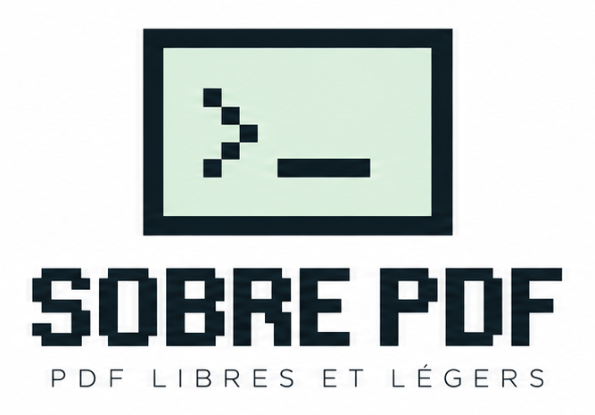

<p align="center">
  
</p>

# SobrePdF

**Un outil PDF frugal, pensé pour aller à l'essentiel.**

SobrePdF est le troisième logiciel de la gamme **Sobre** (*logiciels libres et légers*), après SobreTeX et SobrePiX. Il fait les quelques opérations dont on a besoin au quotidien sur un PDF, et rien d'autre : supprimer, ajouter, réorganiser et faire pivoter des pages, écrire du texte sur une page, remplir un formulaire et apposer une ou deux signatures. L'interface reprend le style Mac 1-bit des années 1990 commun à toute la gamme.

> Version 0.1, premier jet destiné à tester et à amender l'ergonomie.
> © 2026 Auraponymous

---

## Pourquoi

Pour signer une attestation, retirer une page en trop ou remettre un scan à l'endroit, on se retrouve souvent face à deux mauvaises solutions : un logiciel lourd et payant, ou un site web qui demande d'y envoyer son document. Pour un contrat, un bulletin ou un formulaire administratif, ce n'est pas acceptable.

SobrePdF choisit une autre voie :

- **tout reste sur l'ordinateur** : le fichier ne quitte jamais la machine, l'outil fonctionne sans connexion ;
- **peu de fonctions, bien faites** : celles qu'on utilise vraiment, rangées dans une palette d'outils et quelques menus ;
- **l'original n'est jamais modifié** : on enregistre toujours une copie.

---

## Démarrer

SobrePdF tient dans **un seul fichier HTML**, sans installation, sans serveur et sans connexion.

1. Ouvrez `index.html` d'un double-clic dans Firefox ou Chrome.
2. La page d'accueil s'efface après 5 secondes, ou tout de suite au clic ou sur une touche.
3. Ouvrez un PDF avec **Fichier › Ouvrir…** (⌘O / Ctrl+O), ou glissez-le dans la fenêtre.
4. Travaillez dans la vue **Pages** (lire, écrire, signer) ou dans la vue **Planche** (réorganiser). La touche **P** passe de l'une à l'autre.
5. Enregistrez avec **Fichier › Enregistrer une copie…** (⌘S / Ctrl+S). Le nom proposé finit par `_modifie.pdf`.

Le fichier fonctionne aussi depuis une clé USB ou une fois hébergé sur GitHub Pages. Tout est embarqué, polices comprises : aucune ressource n'est chargée depuis Internet.

---

## L'interface

```
┌─ Barre de menus ── Fichier · Édition · Pages · Insertion · Affichage · Fenêtre · Aide ─┐
│ ┌Outils┐ ┌─ Document : nom.pdf (83 %) ───────────────────────┐ ┌ Pages ─────────────┐ │
│ │ ▤  ▦ │ │                                                   ▲│ ├ Texte ─────────────┤ │
│ │ T  ✎ │ │      page 1                                       ││ ├ Signatures ────────┤ │
│ │ ↺  ↻ │ │                                                   ││ └────────────────────┘ │
│ │ ⊕  ⇥ │ │      page 2                                       ││  palettes repliées,    │
│ │ ✕  ↶ │ │                                                   ▼│  dépliées au besoin    │
│ │ +  − │ ├─ barre d'état : page · format · aide contextuelle ─┤                        │
│ └──────┘ └───────────────────────────────────────────────────┘                        │
└────────────────────────────────────────────────────────────────────────────────────────┘
```

- La **palette Outils**, à gauche, reste ouverte. Elle donne accès aux deux vues, aux outils Texte et Signature, aux rotations, à l'insertion et à la suppression de pages, à l'annulation et au zoom.
- Les **palettes de droite** (Pages, Texte, Signatures) sont repliées au démarrage. Chacune garde une place fixe : en se dépliant (double-clic sur la barre de titre, ou en lançant l'outil), elle passe par-dessus les autres sans les décaler. **Fenêtre › Réinitialiser la disposition** remet tout en place.
- La **fenêtre du document** se déplace par sa barre de titre et se redimensionne par le coin. La case de droite la rend à sa taille automatique. Sa barre de défilement est celle de SobreTeX.
- La **barre d'état** indique la page et son format (A4 portrait, Lettre US…), et rappelle ce que fait l'outil en cours.
- Au survol, chaque outil affiche une **bulle** avec son nom et son raccourci.

### Les deux vues

| Vue | Pour quoi faire | Ce qu'on y fait |
|---|---|---|
| **Pages** | Lire, écrire, signer | Pages l'une sous l'autre, zoom ajusté à la largeur. Texte, signatures, formulaires. Glisser le fond fait défiler. |
| **Planche** | Réorganiser | Vignettes de toutes les pages. Glisser pour changer l'ordre, ⌘/Ctrl-clic ou Maj-clic pour choisir plusieurs pages, double-clic pour ouvrir une page. |

---

## Les pages

Les opérations s'appliquent à la **page affichée** dans la vue Pages, ou aux **pages choisies** dans la Planche.

| Opération | Où la trouver |
|---|---|
| Pivoter à gauche / à droite | Outils, palette Pages, menu Pages, touches **Maj+R** / **R** |
| Supprimer | Outils, palette Pages, menu Pages, touche **Suppr** dans la Planche |
| Dupliquer | Palette Pages, menu Pages |
| Mettre au début / à la fin | Palette Pages, menu Pages |
| Réorganiser | Glisser-déposer les vignettes dans la Planche |
| Insérer une page blanche | Outils, palette Pages, menu Insertion (même format que la page voisine) |
| Insérer les pages d'un autre PDF | Outils, palette Pages, menu Insertion : toutes ou une plage, au début, après la page affichée ou à la fin |
| Insérer une image en pleine page | Palette Pages, menu Insertion (page A4, portrait ou paysage selon l'image) |
| Extraire des pages | Palette Pages, **Fichier › Extraire les pages choisies…** : un nouveau PDF avec ces seules pages |

**Assembler plusieurs fichiers** : glissez plusieurs PDF ou images dans la fenêtre vide, ou choisissez-en plusieurs dans **Fichier › Ouvrir…**. Glissés sur un document déjà ouvert, ils peuvent être ajoutés à la fin ou ouverts à sa place.

Un PDF protégé par un mot de passe à l'ouverture le demande dans un dialogue.

---

## Écrire sur la page

- **Outil Texte (T)** : on clique sur la page et on écrit directement dessus. **Entrée** passe à la ligne, **Échap** ou **⌘/Ctrl+Entrée** termine.
- **Police** : Helvetica, Times ou Courier, les trois polices standard du PDF. L'aperçu les remplace à l'écran par des polices de même chasse (Liberation, Arimo, Tinos…), pour que la largeur du texte soit fidèle.
- **Taille** en points, avec des raccourcis 8, 9, 10, 11, 12, 14 et 18.
- **Couleur** parmi les huit couleurs franches de la gamme : noir, blanc, rouge, bleu, jaune, vert, orange, violet. **Gras** en option.
- **Corriger** : double-clic sur le texte. **Déplacer** : glisser, ou les flèches du clavier au point près (Maj : 10 points). **Effacer** : Suppr.
- **Date du jour** : un bouton de la palette Texte l'écrit à l'endroit du curseur.
- Un texte posé sur une page **tourne avec elle** si l'on fait pivoter la page ensuite.

Les polices standard du PDF ne connaissent que le jeu de caractères **WinAnsi** (lettres accentuées françaises, œ, €, guillemets « » compris). Un caractère hors de ce jeu, comme ✓ ou ★, est signalé dans la palette Texte, puis remplacé par « ? » à l'enregistrement.

### Formulaires PDF

Quand le PDF contient de vrais champs à remplir (beaucoup de formulaires CERFA, par exemple), la barre d'état le signale à l'ouverture. **Insertion › Remplir le formulaire…** liste les champs texte, les cases à cocher et les listes, dans l'ordre des pages. Les valeurs s'écrivent dans les champs eux-mêmes et apparaissent aussitôt sur la page.

---

## Les signatures

SobrePdF garde **deux emplacements** de signature, par exemple une signature et un paraphe, ou les signatures de deux personnes.

- **Créer** : dans la palette Signatures, on dessine à la souris, au pavé tactile ou au stylet (encre noire ou bleue, trait fin, moyen ou épais), ou l'on **importe une image** (scan, photo, PNG). Pour une image, le fond blanc est rendu transparent, avec un réglage de force.
- **Placer** : outil Signature (**S**) ou bouton **Placer**, puis un clic sur la page.
- **Ajuster** : glisser pour déplacer, tirer le coin pour agrandir (les proportions sont gardées), Suppr pour effacer.

### Où sont gardées les signatures ?

| Situation | Où vit la signature |
|---|---|
| « Mémoriser » coché (par défaut) | Dans le stockage local du navigateur (`localStorage`, clé `sobre-pdx-signatures`), sur cet ordinateur seulement. Elle revient au prochain lancement. |
| « Mémoriser » décoché | En mémoire, le temps de la session. Elle est oubliée à la fermeture. |
| Sauvegarde conseillée | **Exporter en PNG** depuis la palette Signatures, et garder ce fichier dans un dossier personnel. Pour la retrouver sur un autre poste : **Créer… › Importer une image**. |

Rien n'est envoyé sur Internet. Un autre navigateur, un autre ordinateur ou une navigation privée ne voient pas les signatures mémorisées, et effacer les données de navigation les supprime. **Sur un ordinateur partagé, décochez « Mémoriser »**, et ne gardez pas le PNG sur une clé USB qui circule.

> **Valeur juridique** : une image de signature n'est pas une signature électronique certifiée au sens du règlement européen **eIDAS**. Elle convient aux documents du quotidien. Pour un acte qui exige une signature qualifiée, passez par un service de signature qualifiée.

---

## Enregistrement

| Mécanisme | Rôle |
|---|---|
| **Fichier › Enregistrer une copie…** (⌘S) | Écrit un nouveau PDF. L'original n'est jamais modifié. Avec Chrome, on choisit le dossier ; avec Firefox, le fichier va dans les Téléchargements. |
| **Fichier › Extraire les pages choisies…** | Écrit un PDF avec les seules pages choisies. |
| Annuler / Rétablir | Toutes les opérations s'annulent : pages, textes, signatures, formulaire. |
| Fermer / Quitter | Dans le menu Fichier, avec la question « Ne pas enregistrer / Annuler / Enregistrer ». |
| Alerte de fermeture | Si les modifications ne sont pas enregistrées, le navigateur demande confirmation avant de fermer l'onglet (quand il l'autorise). |

**Deux façons d'enregistrer**, choisies automatiquement :

- si l'ordre et le nombre des pages n'ont pas changé, SobrePdF **repart du fichier d'origine** : formulaires, liens, signets et propriétés sont conservés ;
- sinon, les pages sont **recopiées dans un nouveau PDF** : leur contenu est intact, le titre et l'auteur sont repris, mais les champs de formulaire restent visibles sans être remplissables, et les signets disparaissent.

**PDF protégé** (chiffré, avec ou sans mot de passe) : il s'affiche normalement, mais ses pages ne peuvent pas être recopiées telles quelles. Elles sont enregistrées **en images**, et le texte n'y est plus sélectionnable. SobrePDF prévient avant d'enregistrer.

---

## Raccourcis clavier

SobrePdF affiche ⌘ sur Mac et Ctrl sur Linux et Windows. Les lettres seules marchent quand on n'est pas en train d'écrire.

| Action | Mac | Linux / Windows |
|---|---|---|
| Ouvrir | ⌘O | Ctrl+O |
| Enregistrer une copie | ⌘S | Ctrl+S |
| Annuler / Rétablir | ⌘Z / ⇧⌘Z | Ctrl+Z / Ctrl+Y |
| Vue Pages ↔ Planche | P | P |
| Texte | T | T |
| Signature | S | S |
| Pivoter à droite / à gauche | R / Maj+R | R / Maj+R |
| Effacer l'élément choisi (ou les pages, dans la Planche) | Suppr | Suppr |
| Ajuster l'élément choisi | Flèches (Maj : 10 points) | Flèches (Maj : 10 points) |
| Terminer le texte | ⌘Entrée ou Échap | Ctrl+Entrée ou Échap |
| Zoom avant / arrière | + / − | + / − |
| Ajuster à la largeur / taille réelle | 0 / 1 | 0 / 1 |
| Page précédente / suivante | Page↑ / Page↓ | Page↑ / Page↓ |
| Aller à la page | ⌘G | Ctrl+G |
| Choisir toutes les pages | ⌘A | Ctrl+A |

Fermer et Quitter n'ont **pas** de raccourci : ⌘W, ⌘Q, Ctrl+W et Alt+F4 appartiennent au navigateur ou au système, et aucune page web ne peut les intercepter.

---

## Choix techniques

- **Un seul fichier HTML autonome** (environ 2,2 Mo), sans étape de compilation pour l'utilisateur. Deux bibliothèques libres y sont embarquées :
  - **pdf.js** 3.11.174 (Mozilla, licence Apache 2.0) pour **afficher** les pages ;
  - **pdf-lib** 1.17.1 (licence MIT) pour **écrire** le PDF final : copie des pages, rotations, textes, signatures, formulaires.
- **Travailleur pdf.js** : son code est rangé dans la page et lancé depuis un blob. Ouvert en `file://`, pdf.js croirait sinon le travailleur d'une autre origine et ferait tout le travail dans la page, au risque de la figer.
- **Modèle du document** : une liste de pages, chacune renvoyant à sa source (PDF ouvert, image, page blanche) avec sa rotation ajoutée et ses éléments posés. Rien n'est écrit avant l'enregistrement, ce qui rend l'annulation simple et sûre.
- **Coordonnées** : les textes et signatures sont rangés dans l'espace du PDF, en points. L'écran et le fichier final partagent ainsi la même géométrie, et les éléments tournent avec leur page.
- **Rendu à la demande** : seules les pages visibles sont dessinées, avec un cache limité en mémoire.
- **Stockage** : `localStorage` pour les signatures mémorisées et les préférences (police et couleur du texte, palettes affichées).
- **Police de l'interface** : Pixelify Sans (SIL Open Font License 1.1), embarquée et corrigée comme dans SobrePiX (Z redessiné, © à pleine taille, ligatures retirées).

---

## Limites connues (V0.1)

- **Le texte d'origine du PDF ne se modifie pas** : on écrit par-dessus, on ne corrige pas ce qui est déjà imprimé dans la page.
- **Polices** : Helvetica, Times et Courier seulement, sans italique, et dans le jeu WinAnsi. Pas de retour à la ligne automatique : on passe à la ligne avec Entrée.
- **Réorganiser un PDF à formulaire** fige ses champs (visibles, mais plus remplissables) et retire les signets.
- **PDF protégés** : enregistrés en images, donc plus lourds et sans texte sélectionnable.
- **Formulaires XFA** (certains formulaires dynamiques) : seule leur partie classique (AcroForm) est lue ; sinon, utiliser l'outil Texte.
- **Gros documents** : plusieurs centaines de pages s'ouvrent, mais demandent de la mémoire.
- **Navigateurs** : testé dans Chrome et Chromium. Le comportement dans **Firefox** reste à vérifier, en particulier le stockage local d'un fichier ouvert depuis le disque.
- **Signatures** : image simple, sans valeur de signature électronique qualifiée.

---

## Feuille de route

- [ ] Changer le nom en SobrePdF dans le code, et l'interface.
- [ ] Tester et corriger dans Firefox (Linux et Windows).
- [ ] Implémenter la fonction "Déplacer" pour les pages.
- [ ] Italique et police de l'interface (Pixelify Sans) pour le texte posé.
- [ ] Cases à cocher, croix et traits dessinés, pour les formulaires sans champs.
- [ ] Réglage du poids du fichier (compression des images, pages scannées).
- [ ] Garder les formulaires remplissables après une réorganisation.
- [ ] Version installable (PWA) : icône, fenêtre dédiée, hors ligne.
- [ ] Application de bureau (Tauri) : vrais fichiers sur le disque, raccourcis natifs, signatures dans le dossier de l'utilisateur.
- [ ] Choisir et publier une licence libre (l'EUPL est envisagée).

## Licence

Licence libre **EUPL est envisagée**.
© 2026 **Auraponymous**.

Composants tiers embarqués dans `index.html`, sous leur propre licence :

| Composant | Auteur | Licence |
|---|---|---|
| pdf.js 3.11.174 | Mozilla Foundation | Apache 2.0 |
| pdf-lib 1.17.1 | Andrew Dillon | MIT |
| Pixelify Sans | The Pixelify Sans Project Authors | SIL Open Font License 1.1 |
